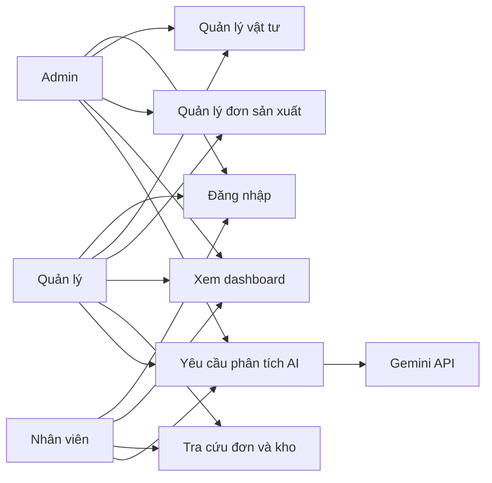
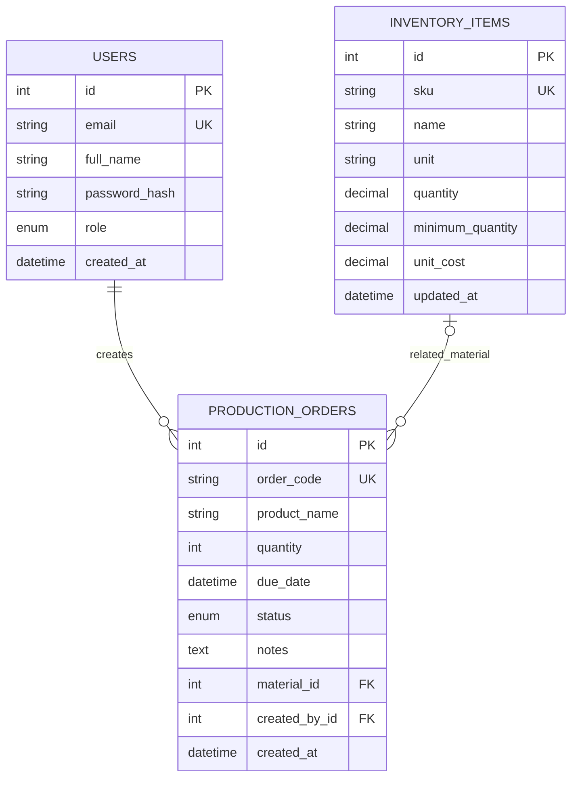
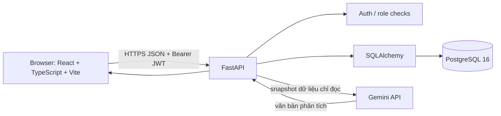

# Tài liệu phân tích và thiết kế

## 1. Bối cảnh và bài toán

Xưởng sản xuất cần theo dõi kế hoạch đơn sản xuất, sản phẩm, hạn hoàn thành và vật tư liên quan. Bản MVP tập trung vào quản lý đơn, số lượng vật tư, ngưỡng tồn tối thiểu và nhận biết đơn đang thực hiện. Dữ liệu được lưu ở PostgreSQL; người quản lý có thể hỏi Gemini để tóm tắt rủi ro và ưu tiên dựa trên dữ liệu hiện có.

### Actor

| Actor | Quyền và nhu cầu |
|---|---|
| Quản trị viên (`admin`) | Đọc/ghi đơn hàng và kho; chịu trách nhiệm cấu hình tài khoản, môi trường và truy cập. |
| Quản lý (`manager`) | Đọc/ghi đơn hàng và kho; xem dashboard; yêu cầu AI phân tích. |
| Nhân viên (`worker`) | Đọc dữ liệu nghiệp vụ/dashboard; yêu cầu AI phân tích; không tạo/sửa/xóa bản ghi. |
| Gemini API | Nhận câu hỏi và snapshot tối thiểu của dữ liệu đơn hàng/kho do backend gửi; không có quyền ghi vào CSDL. |

### Quy trình nghiệp vụ hiện có

1. Quản lý đăng nhập.
2. Thêm/sửa/xóa nguyên vật liệu và cập nhật số lượng/ngưỡng tồn/đơn giá.
3. Tạo đơn sản xuất, liên kết tùy chọn tới một vật tư, đặt số lượng, hạn và trạng thái.
4. Nhân viên/quản lý tìm kiếm, lọc và theo dõi danh sách; dashboard tổng hợp dữ liệu.
5. Người dùng gửi câu hỏi AI; backend lấy dữ liệu theo quyền, gọi Gemini, hiển thị tư vấn; người dùng kiểm chứng rồi tự cập nhật nghiệp vụ.

## 2. Yêu cầu chức năng

| ID | Chức năng | Đầu vào | Xử lý | Đầu ra |
|---|---|---|---|---|
| FR-01 | Đăng nhập | Email, mật khẩu | Kiểm tra hash mật khẩu; cấp JWT có hạn | Token và thông tin vai trò |
| FR-02 | Đọc hồ sơ | Bearer token | Xác minh chữ ký, hạn token và tài khoản | Hồ sơ người dùng |
| FR-03 | Quản lý vật tư | SKU, tên, đơn vị, số lượng, ngưỡng, đơn giá | Validate dữ liệu; kiểm tra SKU duy nhất; role guard | Bản ghi vật tư hoặc lỗi có mã |
| FR-04 | Tìm kiếm/lọc kho | Từ khóa, cờ tồn thấp, tiêu chí sắp xếp | Query SKU/tên và quantity <= minimum | Danh sách vật tư |
| FR-05 | Quản lý đơn | Mã đơn, sản phẩm, số lượng, trạng thái, hạn, vật tư | Validate số lượng/khóa ngoại; kiểm tra mã đơn duy nhất | Bản ghi đơn hoặc lỗi |
| FR-06 | Tìm kiếm/lọc đơn | Từ khóa, trạng thái, thứ tự | Query mã đơn/tên sản phẩm và trạng thái | Danh sách đơn |
| FR-07 | Dashboard | Token | Tổng hợp số đơn, trạng thái, tồn thấp, giá trị kho và đơn gần đây | Các chỉ số dashboard |
| FR-08 | AI hỗ trợ vận hành | Câu hỏi tối đa 1000 ký tự | Backend lấy snapshot chỉ đọc; gọi Gemini với system prompt; giới hạn thời gian/token | Phân tích tiếng Việt, model và phạm vi dữ liệu |

## 3. Yêu cầu phi chức năng

- **Bảo mật:** mật khẩu Argon2; JWT có hạn; mọi API nghiệp vụ cần xác thực; ghi thay đổi chỉ cho admin/manager; API key Gemini giữ ở backend; CORS chỉ cho origin cấu hình.
- **Hiệu năng:** truy vấn danh sách có lọc/sắp xếp, chỉ dashboard tải 5 đơn gần nhất; AI timeout 30 giây và tối đa 1200 output tokens. Phân trang chưa được triển khai.
- **Khả dụng:** lỗi xác thực, dữ liệu trùng, timeout, rate limit và phản hồi AI rỗng trả mã lỗi rõ ràng. Cần bổ sung monitoring/retry có kiểm soát ở giai đoạn triển khai.
- **Toàn vẹn dữ liệu:** unique cho email/SKU/mã đơn; khóa ngoại đơn hàng-người tạo; xóa vật tư được tham chiếu sẽ đặt FK thành null.
- **Sao lưu/khôi phục:** volume PostgreSQL giúp lưu dữ liệu qua restart, nhưng backup định kỳ và diễn tập restore chưa được triển khai.
- **Trải nghiệm:** giao diện responsive mức cơ bản; có thông báo thành công/lỗi, xác nhận trước xóa, trạng thái tải và gợi ý câu hỏi AI.
- **Riêng tư/AI:** chỉ gửi câu hỏi cùng dữ liệu đơn/kho cần thiết; không gửi hash mật khẩu; AI không ghi vào DB; người dùng phải xác minh đề xuất.

## 4. Actor/use case

Nhân viên có quyền đọc và hỏi AI; backend chỉ cấp quyền ghi cho admin/manager.

## 5. Thiết kế cơ sở dữ liệu

- `users.id`, `inventory_items.id`, `production_orders.id`: khóa chính tự tăng.
- `users.email`, `inventory_items.sku`, `production_orders.order_code`: duy nhất.
- `production_orders.created_by_id -> users.id`: bắt buộc, `ON DELETE RESTRICT`.
- `production_orders.material_id -> inventory_items.id`: tùy chọn, `ON DELETE SET NULL`.
- Kiểm tra số lượng và giá không âm, số lượng đơn dương ở schema API. Cần bổ sung CHECK constraints/migrations cho triển khai thật.
- Quan hệ vật tư hiện là vật tư liên quan, chưa phải định mức nguyên liệu (BOM) và chưa tự trừ kho.

## 6. Kiến trúc và luồng dữ liệu

Frontend không gọi Gemini trực tiếp. API key nằm trong biến `GEMINI_API_KEY` ở backend. Flow AI đọc các trường SKU, tên vật tư, số lượng/ngưỡng/đơn giá và thông tin cơ bản của đơn; câu hỏi được giới hạn độ dài. Prompt hướng dẫn không bịa số liệu và không thực hiện giao dịch.

## 7. Prompt và luồng gọi AI

- System prompt lưu tại `backend/app/prompts/operations_system.txt`, được nạp bởi service Gemini.
- User prompt gồm câu hỏi người dùng và JSON snapshot của đơn hàng/vật tư lấy qua backend.
- Output: văn bản tiếng Việt theo các phần Tóm tắt, Nhận định, Đề xuất, Giới hạn; backend kiểm tra response có nội dung trước khi trả UI.
- Giới hạn: 30s timeout, 5s connect timeout, 1200 output tokens; HTTP 429 -> 429, timeout -> 504, lỗi dịch vụ/JSON rỗng -> 502.
- Kết quả là tư vấn, không được thực thi tự động. Dữ liệu đầu vào chưa bao gồm lịch sử tiêu thụ/định mức nên AI không thể dự báo định lượng đáng tin cậy.

## 8. Kế hoạch triển khai tiếp theo

1. **Phân tích/thiết kế:** xác nhận vai trò, quy trình, BOM, công đoạn, ca làm việc, dữ liệu lịch sử và tiêu chí nghiệm thu.
2. **Nền tảng:** hoàn thiện tài khoản/đổi mật khẩu, migrations, audit log, backup/restore và CI.
3. **Nghiệp vụ:** thêm sản phẩm, BOM, công đoạn, phân công nhân công, nhập/xuất kho có transaction, lịch sử biến động.
4. **AI:** thử ít nhất ba phiên bản prompt/model trên bộ dữ liệu chuẩn; đo độ đúng, hallucination và usefulness; lưu prompt/response đã ẩn danh; bổ sung đánh giá thủ công và kiểm soát prompt injection.
5. **Kiểm thử/triển khai:** test API và UI, phân quyền, dữ liệu biên, tải; cấu hình HTTPS, secrets, monitoring, Docker hóa cả app và diễn tập khôi phục.
